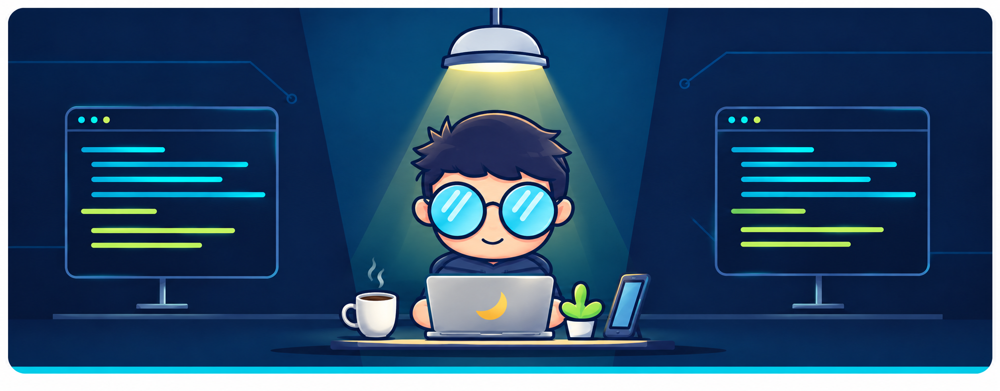

  

  <h3>
    Master's in Software Engineering · Backend &amp; Systems Focus
  </h3>

  

  

    
    
    
  

  

  

I'm <b>Mouaz Naji</b>, a software developer with a master's degree in Software Engineering, focused on problem solving and building dependable software. My strengths span backend systems, full-stack web applications, and mobile development. I break complex challenges into clear solutions, with attention to user needs, clean architecture, and maintainable code.

I work with APIs, databases, and system design, focusing on secure access, data protection, performance, and reliable communication between services. Testing, debugging, and careful code review help me understand failures, improve quality, and keep software easier to maintain as it grows.

My work also covers DevOps and cloud infrastructure: containerizing applications, automating infrastructure, and connecting development, testing, and deployment through CI/CD. I use AI-assisted tools and automation to investigate problems, improve workflows, and reduce repetitive work, whileture, automation, and dependable services.

  
  
  

  
  
  
  
  
  

  
  
  
  
  
  
  
  

  
  
  
  
  
  
  
  

  
  
  
  

  
  
  
  
  
  
  

  
  
  
  

  
  
  
  
  

    

    

   

  

  

 

 &nbsp;
 &nbsp;
 &nbsp;
 &nbsp;

